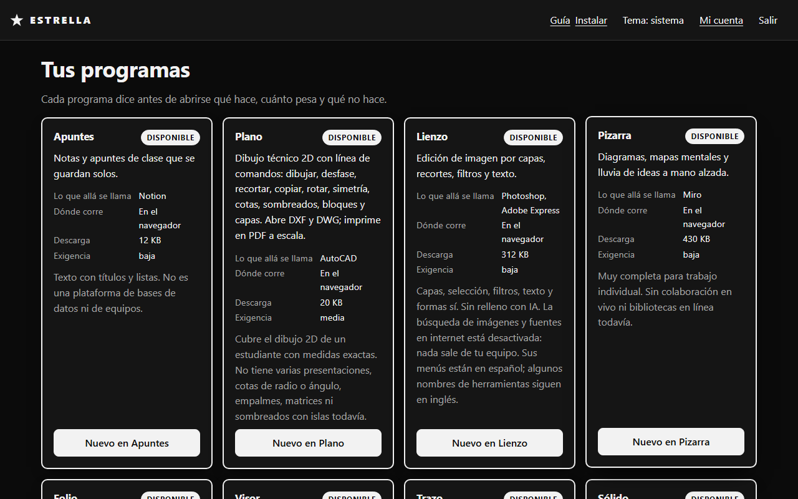
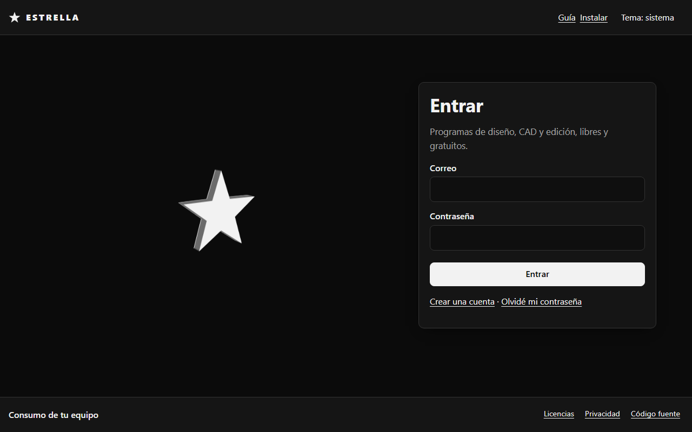
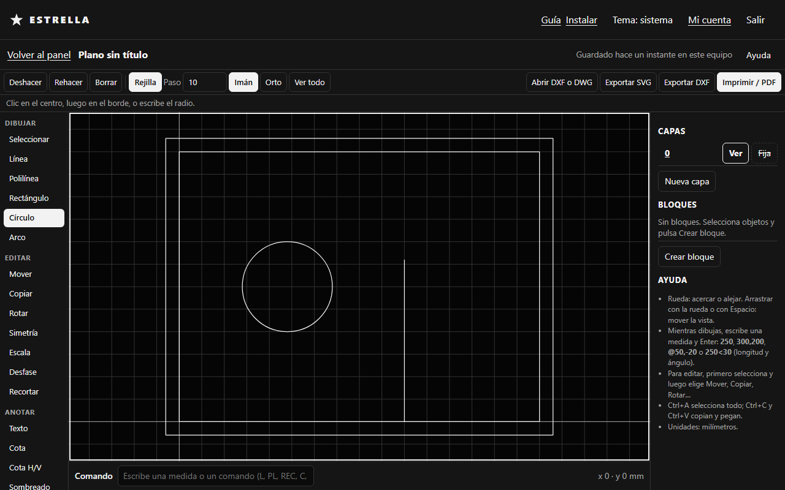
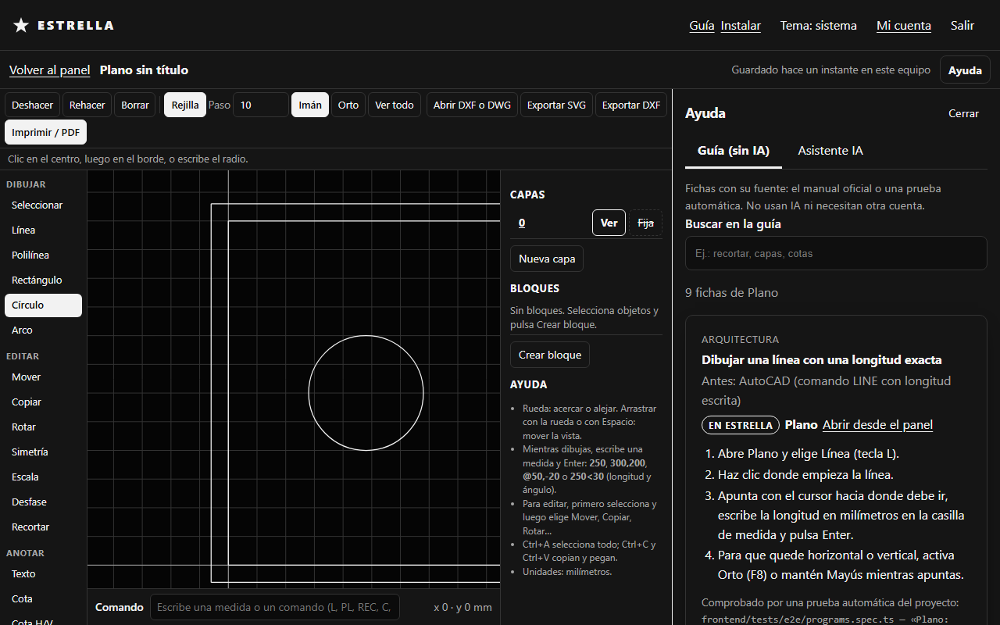
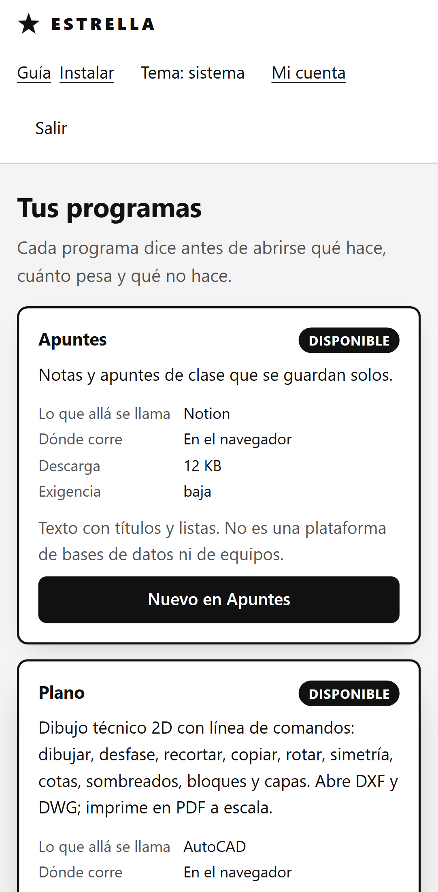
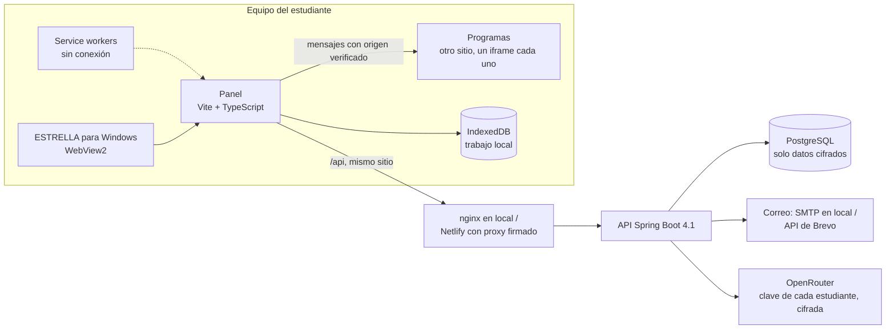
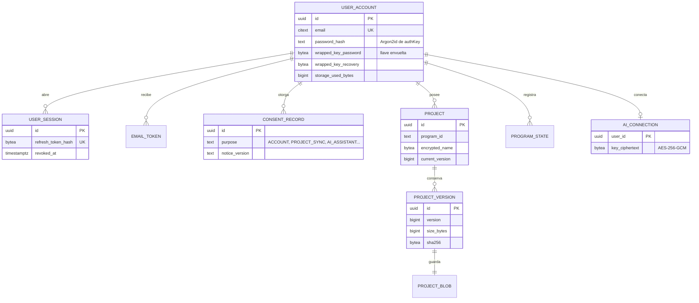

# ESTRELLA

**Programas de diseño, CAD y edición para estudiantes, libres y gratuitos, que abren en el navegador y no piden licencia.**

[](https://github.com/DiegoFranciscoG/estrella/actions/workflows/ci.yml)


[](LICENSE)


## Demo en vivo

**Pendiente de publicar.** El despliegue gratuito está listo y documentado en [docs/despliegue.md](docs/despliegue.md).

No habrá usuario de prueba compartido: el trabajo de cada cuenta se cifra con su propia contraseña. Crear una cuenta toma un minuto. En local, el correo de confirmación llega a Mailpit.

## Capturas



| Entrar | Plano, dibujo técnico 2D | Guía dentro de un programa | En el teléfono |
|---|---|---|---|
|  |  |  |  |

Las capturas salen del stack local con `E2E_SCREENSHOTS=1 npx playwright test --project=docs`.

## Problema que resuelve

Un estudiante de arquitectura o diseño gráfico necesita unos 19 programas de pago: CAD, edición de imagen, maquetación, BIM, render y otros (la lista y su equivalente libre están en [docs/catalogo.md](docs/catalogo.md)). Las licencias cuestan más de lo que muchos pueden pagar, y las copias piratas traen malware y riesgo legal.

ESTRELLA ofrece una alternativa legal y gratuita:

- **Programas propios o integrados** desde proyectos libres, que abren en el navegador.
- **Una guía** que traduce «cómo lo hacía en el programa de pago» a «cómo se hace aquí», con fuente.
- **Instalación de los programas libres de escritorio**, como Blender o FreeCAD, desde su sitio oficial.

Todo funciona en equipos modestos y sin conexión, y el servidor nunca puede leer el trabajo del estudiante.

## Funcionalidades

- **Seis programas en el navegador**:
  - **Apuntes** (notas).
  - **Plano** (CAD 2D con línea de comandos y capas; abre DXF y DWG e imprime en PDF a escala).
  - **Lienzo** (imagen por capas).
  - **Pizarra** (diagramas a mano alzada).
  - **Folio** (unir, girar y borrar páginas de PDF sin subirlos).
  - **Visor** (abre y convierte DWG, DXF, PDF, PSD, SVG, fotos y RAW de cámara, OBJ, STL, 3MF, glTF e IFC).
- **Autoguardado y recuperación:** tras un cierre brusco se pierden menos de 30 segundos. Un programa que se cuelga no tumba el panel.
- **Cuenta con correo y contraseña.**
  - La contraseña nunca sale del equipo.
  - La sincronización en la nube es opcional, va cifrada de extremo a extremo y guarda versiones.
  - Dos equipos nunca se pisan el trabajo.
- **Guía de equivalencias:** se busca por el nombre del comando del programa de pago. Cada ficha cita el manual oficial o la prueba automática que la respalda.
- **Asistente de IA opcional**, con la cuenta gratuita de OpenRouter del estudiante: solo modelos gratuitos y solo para mayores de 18 años, como piden los términos del proveedor.
- **Medidor de consumo del equipo**, y un agradecimiento a cada proyecto libre la primera vez que se abre su programa.
- **Instalable:**
  - Como app web en Android, iPhone, Windows, Mac y Linux.
  - Como **ESTRELLA para Windows**: 1,3 MB, sin permisos de administrador. Instala los programas libres de escritorio con winget, desde su fuente oficial. Cada versión se compila y publica en GitHub Releases, con su SHA-256.
- **Diseño en blanco y negro con una estrella 3D**, temas claro y oscuro, accesible (WCAG 2.2 AA).
- **Privacidad según la LOPDP de Ecuador:** consentimientos separados, exportación de datos y borrado total de la cuenta.

## Arquitectura



- **El panel y los programas viven en sitios distintos.** El navegador ejecuta cada programa en su propio proceso, y un programa nunca toca la sesión del panel.
- **El dispositivo cifra** nombres y contenido con AES-GCM antes de subirlos. La API guarda bytes que no puede leer y controla versiones con `If-Match` y `ETag` (RFC 9110).

## Stack y por qué

| Pieza | Elección | Por qué |
|---|---|---|
| Panel | Vite 8 + TypeScript, sin framework | Primera carga de 148 KB comprimidos; abre en menos de 1 s instalado |
| Programas | Propios (Plano, Apuntes, Folio, Visor) e integrados (Excalidraw, miniPaint), cada uno aislado | Fallos y licencias quedan separados (GPL solo dentro de su propio worker) |
| API | Spring Boot 4.1 y Java 17, Spring Security, `JdbcClient` | SQL explícito y parametrizado, sin ORM: se ve exactamente qué se consulta |
| Base de datos | PostgreSQL 18 con Flyway | Migraciones versionadas; Neon gratis en producción |
| Criptografía | Web Crypto (PBKDF2, HKDF, AES-GCM) en el equipo; Argon2id en el servidor | El servidor no puede leer el trabajo, y una base robada no revela contraseñas |
| Pruebas | JUnit 5, Testcontainers, Vitest, Playwright y axe-core | Base real en contenedor, y pruebas de extremo a extremo como las haría un estudiante |
| Contenedores | Docker multi-etapa, nginx y JRE sin privilegios | `docker compose up --build` levanta todo |
| Escritorio | .NET Framework 4.8 + WebView2 | Ya vienen con Windows: un solo archivo de 1,3 MB |
| Despliegue | Netlify, Render, Neon y Brevo, en planes gratuitos | Costo cero, con límites verificados |

## Modelo de datos



El modelo completo, con restricciones y la fuente de cada regla, está en [docs/modelo-datos.md](docs/modelo-datos.md).

## Cómo ejecutar en local

### Con Docker

```bash
cp .env.example .env
```

Cambia cada `CAMBIAR` en `.env`:

- `POSTGRES_PASSWORD`: cualquier contraseña.
- `JWT_SECRET`: el resultado de `openssl rand -base64 48`.
- `AI_KEY_SECRET`: el resultado de `openssl rand -base64 32`.

Luego levanta todo:

```bash
docker compose up --build
```

| Qué | Dónde |
|---|---|
| Panel | http://localhost:8088 |
| Programas (otro sitio) | http://127.0.0.1:8089 |
| Correos de prueba (Mailpit) | http://localhost:8025 |
| Swagger UI | http://localhost:8088/api/docs |

El asistente usa en local un simulador de OpenRouter (`dev/openrouter-sim`), sin llamadas reales.

### Sin Docker

Necesitas Java 17, Maven 3.9, Node 24, PostgreSQL 18 y un buzón SMTP de pruebas (por ejemplo, Mailpit en el puerto 1025).

1. Crea la base y define las variables de la tabla de abajo:
   - `DATABASE_URL=jdbc:postgresql://localhost:5432/estrella`
   - `APP_PUBLIC_URL` y `APP_CORS_ORIGINS` en `http://localhost:5173`
   - `MAIL_HOST=localhost`, `MAIL_PORT=1025`, `MAIL_SMTP_AUTH=false` y `MAIL_STARTTLS=false`
   - `APP_COOKIE_SECURE=false`
2. Arranca la API (puerto 8080):

   ```bash
   cd backend && mvn spring-boot:run
   ```
3. En `frontend/`, instala las dependencias:

   ```bash
   npm ci
   ```
4. Arranca los programas, en `http://127.0.0.1:5174`:

   ```bash
   npm run dev:apps
   ```
5. En otra terminal, arranca el panel en `http://localhost:5173`. Reenvía `/api` a la API:

   ```bash
   VITE_APPS_ORIGIN=http://127.0.0.1:5174 npm run dev
   ```

## Variables de entorno

La API no arranca si falta una variable marcada como obligatoria. Ningún secreto tiene valor por defecto.

| Variable | Obligatoria | Para qué |
|---|---|---|
| `DATABASE_URL`, `DATABASE_USERNAME`, `DATABASE_PASSWORD` | Sí | PostgreSQL (JDBC) |
| `JWT_SECRET` | Sí | Firma de los tokens de acceso (al menos 32 bytes aleatorios) |
| `AI_KEY_SECRET` | Sí | Cifra las claves de OpenRouter guardadas (exactamente 32 bytes en base64) |
| `APP_PUBLIC_URL` | Sí | URL del panel, para los enlaces de los correos |
| `APP_CORS_ORIGINS` | Sí | Orígenes permitidos, separados por coma |
| `MAIL_FROM` | Sí | Remitente de los correos |
| `APP_MAIL_PROVIDER` | No (`smtp`) | `smtp` o `brevo` (Render gratis bloquea SMTP) |
| `MAIL_HOST`, `MAIL_PORT`, `MAIL_USERNAME`, `MAIL_PASSWORD`, `MAIL_SMTP_AUTH`, `MAIL_STARTTLS` | Con `smtp` | Servidor SMTP |
| `BREVO_API_KEY` | Con `brevo` | Clave de la API de Brevo |
| `APP_PROXY_SECRET` | En producción | Secreto con el que Netlify firma lo que reenvía a la API |
| `APP_PROXY_CLIENT_IP_HEADER` | No | Cabecera con la dirección del estudiante detrás del proxy |
| `APP_COOKIE_SECURE`, `APP_COOKIE_SAME_SITE` | No (`true`, `Strict`) | Cookie de renovación de sesión |
| `APP_STORAGE_QUOTA_BYTES` | No (25 MiB) | Espacio en la nube por estudiante |
| `APP_SYNC_MAX_VERSION_BYTES`, `APP_SYNC_VERSIONS_KEPT`, `APP_SYNC_MAX_PROJECTS`, `APP_SYNC_UPLOADS_PER_MINUTE` | No | Límites de la sincronización |
| `APP_MAIL_PER_HOUR` | No (200) | Techo de correos por hora, para todos |
| `APP_MAX_JSON_BYTES` | No (128 KB) | Cuerpo JSON más grande aceptado |
| `APP_AI_BASE_URL`, `APP_AI_AUTH_URL`, `APP_AI_MODELS`, `APP_AI_REQUESTS_PER_MINUTE`, `APP_AI_MAX_MESSAGE_CHARS`, `APP_AI_MAX_OUTPUT`, `APP_AI_TIMEOUT` | No | Asistente; solo acepta modelos `:free` |
| `APP_API_DOCS` | No (`false`) | Publica OpenAPI y Swagger UI (solo en local) |
| `POSTGRES_DB`, `POSTGRES_USER`, `POSTGRES_PASSWORD`, `PANEL_ORIGIN`, `APPS_ORIGIN` | Solo Docker Compose | Base local y orígenes de los dos sitios |

Valores de ejemplo en [.env.example](.env.example).

## API

El contrato completo está en [docs/openapi.json](docs/openapi.json) (OpenAPI 3.1). En local, Swagger UI vive en http://localhost:8088/api/docs. Hay ejemplos listos para usar en [docs/http/api.http](docs/http/api.http).

| Método y ruta | Qué hace |
|---|---|
| `POST /api/v1/auth/register` · `verify-email` · `login` · `refresh` · `logout` | Cuenta y sesión |
| `POST /api/v1/auth/password-reset/request` · `bundle` · `confirm` | Cambiar la contraseña, conservando los proyectos con el código de recuperación |
| `GET /api/v1/me` · `GET /api/v1/me/export` · `POST /api/v1/me/delete` | Perfil, exportación y borrado de la cuenta |
| `PUT` / `DELETE /api/v1/me/consents/{purpose}` | Dar o retirar cada consentimiento |
| `GET /api/v1/projects` · `PUT /api/v1/projects/{id}` | Listar y crear proyectos (nombre cifrado) |
| `PUT` / `GET /api/v1/projects/{id}/content` | Subir una versión cifrada (`If-Match`) o bajar la actual (`ETag`, `304`) |
| `GET /api/v1/ai/status` · `PUT /api/v1/ai/connection` · `POST /api/v1/ai/chat` | Conectar OpenRouter (PKCE) y preguntar |
| `GET /api/v1/health` | ¿Está despierta la API? |

Los errores siguen el RFC 9457 (`application/problem+json`): traen un `code` estable y un `detail` en español.

## Pruebas y cobertura

| Parte | Qué cubre | Resultado |
|---|---|---|
| Backend (JUnit 5, Testcontainers con PostgreSQL 18 real) | 92 pruebas: cuentas, frenos, sincronización, asistente, contrato OpenAPI, proxy firmado y correo | **93,5 % de líneas**, 79,2 % de ramas (JaCoCo; el build falla por debajo de 70 %) |
| Frontend (Vitest) | 184 pruebas: criptografía, sincronización, guía, programas, service workers y cabeceras de Netlify | **88,2 % de líneas** de la lógica |
| Extremo a extremo (Playwright, contra `docker compose`) | Recorridos completos de estudiante, cada programa, sin conexión, móvil, accesibilidad WCAG 2.2 AA con axe en ambos temas, y rendimiento T-06 | En CI |
| ESTRELLA para Windows (xUnit) | Navegación permitida, mensajes y lista de instalación | En CI |

```bash
cd backend && mvn verify
```

```bash
cd frontend && npm test
```

```bash
cd frontend && npx playwright test
```

La última necesita el stack de Docker en marcha.

## Despliegue

Todo en planes gratuitos, con los límites verificados en sus páginas oficiales:

- **Netlify:** dos sitios, el panel y los programas.
- **Render:** la API en Docker, con [render.yaml](render.yaml).
- **Neon:** PostgreSQL.
- **Brevo:** el correo.

El paso a paso, qué hacer si un nombre está tomado y cómo cuidar los créditos de cada plan están en [docs/despliegue.md](docs/despliegue.md).

## Seguridad aplicada

Auditoría completa, con la prueba que respalda cada control: [docs/seguridad.md](docs/seguridad.md). Cubre OWASP Top 10:2025, API Security Top 10:2023 y Top 10 for LLM Applications 2025.

- **Cifrado de extremo a extremo:** la contraseña nunca viaja (PBKDF2 de 600 000 iteraciones y HKDF en el equipo; Argon2id en el servidor).
- **Denegar por defecto:** CORS explícito, cabeceras estrictas y una CSP por tipo de recurso, sin scripts en línea.
- **Frenos contra adivinar contraseñas:** por cuenta y por dirección, que no se esquivan escribiendo `X-Forwarded-For`.
- **Sesión:** token de acceso de 15 minutos solo en memoria. La renovación rota en cada uso; reutilizar una vieja cierra todas las sesiones.
- **Límites de tamaño, cuota y frecuencia** en cada recurso. Errores sin detalles internos.
- **Secretos solo por variables de entorno**, y gitleaks en cada commit y en CI. Acciones de GitHub fijadas por SHA.

Para reportar una vulnerabilidad, ver [SECURITY.md](SECURITY.md).

## Decisiones técnicas

- **Programas libres integrados, no clones de los de pago:** cambiarle el nombre a una copia no la vuelve legal. La guía dice con honestidad qué hace cada herramienta y qué no.
- **Dos sitios y un `iframe` por programa:** aislamiento de procesos y de licencias. La GPL del lector DWG queda dentro de su propio worker y el resto sigue siendo MIT.
- **Sin ORM:** con `JdbcClient` cada consulta es SQL visible y parametrizado. Las versiones usan bloqueo por fila e `If-Match`.
- **Clave de IA en el servidor, cifrada:** la regla del proyecto prohíbe claves en el navegador, así que la API hace de proxy, con límites.
- **Correo por API HTTPS en producción**, porque Render gratis bloquea SMTP. El transporte se elige por configuración.
- **Las cabeceras de Netlify se generan de la configuración de nginx:** una sola fuente de verdad, comparada archivo por archivo (511 archivos, 0 diferencias).
- **Sin reintentos de escrituras:** mientras la API gratuita despierta, la app solo repite peticiones idempotentes (RFC 9110).

Las razones completas, con sus fuentes, están en [docs/investigacion.md](docs/investigacion.md) y [docs/plan.md](docs/plan.md).

## Roadmap

- Publicar la demo (después de revisar marca en SENADI y completar los datos del responsable del tratamiento).
- Programas planificados: Trazo (vectores), Sólido (modelado 3D paramétrico), BIM, Revelado (fotos RAW), Archivo y Análisis de sitio.
- Probar en macOS, Linux, Safari y teléfonos reales, y con lectores de pantalla.
- Firmar ESTRELLA para Windows (Microsoft Store) y escanear las imágenes Docker en CI.
- Donaciones, al final y por configuración.

## Fuentes de datos y licencias

- **Código de ESTRELLA:** [MIT](LICENSE).
- **Programas libres integrados:** Excalidraw (MIT), miniPaint (MIT), PDF.js (Apache-2.0), pdf-lib (MIT), three.js (MIT), web-ifc (MPL-2.0), LibreDWG (GPL-3.0, aislado) y otros.
  - Cada componente y la obligación que trae están en [docs/licencias.md](docs/licencias.md).
  - Cada compilación genera `THIRD-PARTY-NOTICES.txt`, enlazado desde la página de licencias de la app.
- **Equivalencias de la guía:** salen de los manuales oficiales de cada programa, citados en cada ficha, o de las pruebas automáticas del repositorio.
- **Datos de ejemplo:** las pruebas y los seeds usan datos ficticios (`example.com`); no hay datos personales reales.

## Autor

**Diego Francisco Granda Zhingre**

- GitHub: [DiegoFranciscoG](https://github.com/DiegoFranciscoG)
- Instagram: [@diego.granda.z](https://www.instagram.com/diego.granda.z/)
- LinkedIn: [Diego Francisco Granda Zhingre](https://www.linkedin.com/in/diego-francisco-g-61b793254/)
