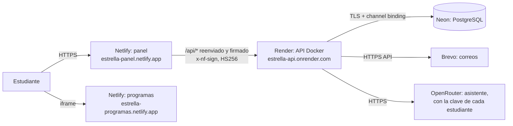

# Despliegue gratuito

ESTRELLA se publica en cuatro servicios con plan gratuito: **Netlify** sirve el panel y los programas, **Render** ejecuta la API, **Neon** guarda la base de datos y **Brevo** envía los correos. Los límites de cada plan se verificaron en sus páginas oficiales el 2026-11-07 (tabla al final).



**Por qué así:**

- El navegador solo habla con el sitio del panel. La API se alcanza por `/api` del mismo sitio, así que la cookie de sesión es de primera parte (`SameSite=Strict`) y no depende de cookies de terceros.
- Netlify **firma** cada petición que reenvía. La API rechaza las que llegan a `/api` sin esa firma, con `403 PROXY_REQUIRED`. Sin esto, la API vería a todos los estudiantes con la dirección de Netlify, y los frenos por dirección los meterían a todos en el mismo grupo.
- Los programas van en **otro sitio**, para que el navegador los ejecute en un proceso aparte. Las cabeceras de los dos sitios salen de `frontend/nginx.conf.template`, las mismas del stack local; el generador está en `frontend/scripts/netlify-headers.ts`.
- Render gratis **bloquea los puertos SMTP**, por eso los correos salen por la API HTTPS de Brevo (`APP_MAIL_PROVIDER=brevo`).

## Demo sin servidor (la que está publicada)

Sin la API no hay cuentas, así que esta versión abre directo en **modo sin cuenta**: los programas funcionan y el trabajo se queda en el navegador. No necesita Neon, Brevo, Render ni secretos, y no recoge datos personales. Publicarla solo requiere una sesión de Netlify.

Desde `frontend/`, con la herramienta de Netlify autenticada (`npx netlify-cli login`):

```bash
export PANEL_ORIGIN=https://estrella-panel.netlify.app APPS_ORIGIN=https://estrella-programas.netlify.app VITE_APPS_ORIGIN=https://estrella-programas.netlify.app VITE_ACCOUNTS=off
```

```bash
npm run build
```

```bash
node scripts/netlify-site.mjs panel /tmp/estrella-panel && node scripts/netlify-site.mjs programs /tmp/estrella-programas
```

Publica cada carpeta desde **fuera del repositorio** (allí no hay `netlify.toml`, y el sitio del panel no intenta reenviar `/api`). Indica siempre `--site`: la herramienta recuerda el último sitio de esa carpeta y, sin ese dato, publicaría encima de él.

```bash
cd /tmp && npx netlify-cli deploy --prod --no-build --dir estrella-panel --site estrella-panel
```

```bash
cd /tmp && npx netlify-cli deploy --prod --no-build --dir estrella-programas --site estrella-programas
```

Cada publicación a producción consume 15 de los 300 créditos mensuales del plan gratuito.

En el plan gratuito, Netlify agrega a cada página un script suyo (`/.netlify/scripts/hud`). Nuestra CSP bloquea su parte en línea: verás ese aviso en la consola, sin efecto en la pantalla.

Para pasar a la versión completa, con cuentas y nube, sigue el resto de esta guía. Los dos sitios de Netlify ya existen: en el paso 5 vincula el repositorio a cada uno en lugar de crearlos.

## Antes de empezar

- El repositorio debe estar en GitHub. Lo publicas tú después de «VOY A SUBIR».
- Necesitas cuentas en Neon, Brevo, Render y Netlify.
  - Neon y Brevo dicen en sus páginas que su plan gratuito no pide tarjeta.
  - Render no pide medio de pago para crear una instancia gratuita. Sin tarjeta registrada, si se pasa de tráfico o de minutos de build, suspende en vez de cobrar.
  - El plan gratuito de Netlify tiene un tope duro y no deja comprar créditos. No encontré escrito si pide tarjeta al registrarse; si te la pide, detente y avísame.
- Elige los nombres. Esta guía usa `estrella-panel`, `estrella-programas` y `estrella-api`. Si alguno está tomado, mira «Si cambian los nombres».

## 1. Base de datos: Neon

1. Crea un proyecto en la región **AWS US East (N. Virginia)**, cerca de la API.
2. En «Connect», elige la conexión **directa**, sin `-pooler`. Flyway y el pool propio de la API, de 3 conexiones, no necesitan PgBouncer.
3. Arma la URL JDBC con el host y la base, sin usuario ni contraseña:

   ```text
   jdbc:postgresql://HOST/BASE?sslmode=require&channelBinding=require
   ```

   Es la forma que da la guía de Java de Neon. Con *channel binding* (SCRAM-SHA-256-PLUS), un intermediario no puede completar la autenticación.
4. Guarda aparte el usuario y la contraseña: van en `DATABASE_USERNAME` y `DATABASE_PASSWORD`.

## 2. Correo: Brevo

1. Crea la cuenta y espera a que Brevo la apruebe para enviar.
2. En «Senders», agrega y verifica la dirección que enviará los correos (`MAIL_FROM`).
   - Con un dominio propio, autentícalo (SPF y DKIM).
   - Si usas una dirección de un dominio con DMARC estricto, Brevo exige autenticar el dominio.
3. Crea una clave de API (`BREVO_API_KEY`). Guárdala solo en Render.

El plan gratuito envía **300 correos al día**. Por eso `render.yaml` pone `APP_MAIL_PER_HOUR=12` (12 × 24 = 288). Al llegar al tope, la API responde «Intenta en unos minutos», en vez de que Brevo descarte correos sin avisar.

## 3. Secreto del proxy

Genera un secreto una sola vez:

```bash
openssl rand -base64 48
```

Ese mismo valor va en Render (`APP_PROXY_SECRET`) y en Netlify (`API_PROXY_SECRET`). La API exige al menos 32 bytes.

## 4. API: Render

1. En Render: **New → Blueprint**, elige el repositorio. Render lee `render.yaml` de la raíz.
2. Completa los valores que pide (los marcados `sync: false`): `DATABASE_URL`, `DATABASE_USERNAME`, `DATABASE_PASSWORD`, `APP_PROXY_SECRET`, `BREVO_API_KEY` y `MAIL_FROM`.
   - `JWT_SECRET` y `AI_KEY_SECRET` los genera Render: valores aleatorios de 256 bits.
3. Espera el primer despliegue.
   - Render da por buena la API cuando `/actuator/health` responde 2xx en menos de 5 segundos. Esa ruta también comprueba la base.
   - Si falta una variable crítica, la API no arranca y el despliegue falla, a propósito.
4. Anota la URL que te dio Render.
   - Si no es `https://estrella-api.onrender.com`, cámbiala en `deploy/netlify/panel/netlify.toml` (línea `to = ...`).

Una vez desplegada, la API ya no se deja usar sin pasar por el panel:

```bash
curl -i https://estrella-api.onrender.com/api/v1/health
```

Debe responder `403` con `PROXY_REQUIRED`.

## 5. Panel: Netlify

1. **Add new project → Import an existing project**, elige el repositorio.
2. En la configuración del sitio:
   - **Package directory** `deploy/netlify/panel` (solo se puede poner en la interfaz).
   - **Base directory** vacío.
   - El build, la carpeta publicada y las variables no secretas ya están en ese `netlify.toml`.
3. En las variables de entorno del sitio, agrega `API_PROXY_SECRET` con el valor del paso 3.
   - En el plan gratuito las variables valen para todos los ámbitos, incluido *Runtime*, que es el que usa la firma del proxy.
   - No lleva el prefijo `VITE_`, así que nunca entra en el JavaScript del navegador.
4. Cambia el nombre del sitio a `estrella-panel` y despliega.

## 6. Programas: Netlify

Igual que el panel, con **Package directory** `deploy/netlify/programs` y el nombre `estrella-programas`. Este sitio no necesita secretos.

## 7. ESTRELLA para Windows

El flujo `.github/workflows/release.yml` corre al subir una etiqueta de versión. Prueba la app de escritorio, compila `ESTRELLA.exe` apuntando al panel publicado y lo adjunta, con su SHA-256, a una «Release» de GitHub. La página «Instalar» enlaza a `releases/latest/download/ESTRELLA.exe`:

```bash
git tag v1.0.0
```

```bash
git push origin v1.0.0
```

## 8. Comprobar

1. Las cabeceras del panel deben incluir la CSP con `frame-src https://estrella-programas.netlify.app` y `frame-ancestors 'none'`:

   ```bash
   curl -sI https://estrella-panel.netlify.app/
   ```
2. Revisa el lector DWG en el sitio de programas:

   ```bash
   curl -sI https://estrella-programas.netlify.app/apps/visor/index.html
   ```

   Debe responder con su propia CSP.
3. Abre el panel, crea una cuenta y confirma el correo. El primer pedido despierta a la API: puede tardar cerca de un minuto, y la app lo avisa.
4. En los registros de Render debe aparecer **una vez** esta línea:

   ```text
   Signed proxy verified; student addresses are read from X-Nf-Client-Connection-Ip
   ```

   Si dice `X-Forwarded-For`, también funciona. Si dice `the proxy's own address`, Netlify no envió la dirección del estudiante y los frenos por dirección quedan compartidos (ver «Supuestos»).
5. Abre un programa, guarda un proyecto y sincronízalo.

## Si cambian los nombres

| Si cambia… | Edita |
|---|---|
| La URL de la API | `deploy/netlify/panel/netlify.toml`: `to` |
| El sitio del panel | `render.yaml`: `APP_PUBLIC_URL` y `APP_CORS_ORIGINS`. Los dos `netlify.toml`: `PANEL_ORIGIN`. `.github/workflows/release.yml`: `ESTRELLA_URL` |
| El sitio de programas | Los dos `netlify.toml`: `APPS_ORIGIN` y `VITE_APPS_ORIGIN` |

Con un dominio propio aplica lo mismo. La firma de Netlify lleva la URL del sitio (`site_url`), y la API la compara con `APP_PUBLIC_URL`.

## Cuidar los planes gratuitos

| Servicio | Plan gratuito (verificado el 2026-11-07) | Qué pasa al llegar al límite | Cómo lo cuidamos |
|---|---|---|---|
| [Netlify](https://docs.netlify.com/manage/accounts-and-billing/billing/billing-for-credit-based-plans/how-credits-work/) | 300 créditos al mes. Un despliegue de producción cuesta 15; 1 GB de tráfico, 20; 10 000 peticiones, 2 | **Todos los sitios se pausan** hasta el siguiente ciclo; el plan gratuito no puede comprar más | `ignore` en cada `netlify.toml`: solo se construye si cambió `frontend/`. Trabaja en ramas y fusiona a `main` para publicar: los despliegues de rama no cuestan créditos |
| [Render](https://render.com/docs/free) | 750 horas al mes por workspace; 512 MB y 0,1 CPU; duerme tras 15 min sin tráfico y tarda cerca de un minuto en despertar | Suspende los servicios gratuitos hasta el mes siguiente. Sin tarjeta, lo mismo si se acaba el tráfico incluido | `rootDir: backend`: solo se redespliega si cambia el backend. La app avisa mientras despierta y nunca repite una escritura |
| [Neon](https://neon.com/pricing) | 1 GB por proyecto, 100 CU-hora al mes, 5 GB de transferencia; se apaga tras 5 min sin uso | Se suspende el cómputo hasta el siguiente periodo | Cuota de 25 MiB por estudiante (`APP_STORAGE_QUOTA_BYTES`). La base duerme cuando la API duerme |
| [Brevo](https://www.brevo.com/features/email-api/) | 300 correos al día | No envía más ese día | `APP_MAIL_PER_HOUR=12` |

## Supuestos y riesgos que quedan

- **Dirección del estudiante.** Netlify documenta la firma (`x-nf-sign`, HS256, con `iss`, `exp`, `site_url`, `deploy_context` y `netlify_id`), pero no qué cabecera lleva la IP del visitante al origen.
  - La API usa `X-Nf-Client-Connection-Ip` y, si falta, la última dirección de `X-Forwarded-For`.
  - Solo confía en ellas cuando la firma es válida. El paso 8.4 lo confirma.
  - La cabecera se cambia con `APP_PROXY_CLIENT_IP_HEADER`.
- **Builds cancelados por `ignore`.** Netlify cobra los despliegues de producción exitosos. No encontré escrito que uno cancelado no cueste, pero no es un despliegue exitoso.
- **El token de acceso** sigue siendo válido hasta que vence (15 minutos) aunque el estudiante salga. Vive solo en memoria y se renueva con rotación y detección de reutilización.
- **Primer acceso tras dormir:** la API tarda cerca de un minuto. El panel instalado abre al instante con su copia local; solo esperan las acciones que necesitan la API.
- **Cuotas de los planes:** pueden cambiar. Revisa las páginas de la tabla antes de publicar.
