# Modelo de datos

El servidor guarda lo mínimo. El contenido de los proyectos llega cifrado y **los nombres de proyecto también**: así el servidor no conoce ni el título del trabajo. Esto va un paso más allá del documento original, que dejaba el nombre visible.

La migración propuesta está en `backend/src/main/resources/db/migration/V1__init.sql`.

```mermaid
erDiagram
    USER_ACCOUNT ||--o{ USER_SESSION : abre
    USER_ACCOUNT ||--o{ EMAIL_TOKEN : recibe
    USER_ACCOUNT ||--o{ CONSENT_RECORD : otorga
    USER_ACCOUNT ||--o{ PROJECT : posee
    USER_ACCOUNT ||--o{ PROGRAM_STATE : registra
    PROJECT ||--o{ PROJECT_VERSION : conserva

    USER_ACCOUNT {
        uuid id PK
        citext email UK
        text password_hash
        timestamptz email_verified_at
        bytea wrapped_key_password
        bytea wrapped_key_recovery
        bytea key_salt
        bytea avatar
        bigint storage_used_bytes
        bigint storage_quota_bytes
    }
    USER_SESSION {
        uuid id PK
        uuid user_id FK
        bytea refresh_token_hash UK
        timestamptz expires_at
        timestamptz revoked_at
    }
    EMAIL_TOKEN {
        uuid id PK
        uuid user_id FK
        text purpose
        bytea token_hash UK
        timestamptz expires_at
        timestamptz used_at
    }
    CONSENT_RECORD {
        uuid id PK
        uuid user_id FK
        text purpose
        text notice_version
        timestamptz granted_at
        timestamptz revoked_at
    }
    PROJECT {
        uuid id PK
        uuid user_id FK
        text program_id
        bytea encrypted_name
        bigint current_version
        timestamptz updated_at
    }
    PROJECT_VERSION {
        uuid id PK
        uuid project_id FK
        bigint version
        text storage_key UK
        bigint size_bytes
        bytea nonce
        bytea sha256
    }
    PROGRAM_STATE {
        uuid user_id PK
        text program_id PK
        timestamptz thanks_seen_at
    }
```

## Reglas y su origen

| Regla | Campo o restricción | Origen |
|---|---|---|
| Solo correo y contraseña; sin teléfono, cédula ni nacimiento | `user_account` sin esos campos | Pedido + LOPDP art. 10 (minimización) |
| Foto opcional, máximo 256 KB | `CHECK` sobre `avatar` | Pedido; límite propuesto |
| Contraseña con Argon2id | `password_hash` | OWASP; documento ESTRELLA |
| Tokens guardados solo como hash | `token_hash`, `refresh_token_hash` | Buena práctica OWASP |
| Consentimiento por finalidad, versionado y revocable | `consent_record` | LOPDP art. 8 |
| Borrado real en cascada | `ON DELETE CASCADE` más borrado del almacén | LOPDP art. 15; T-10 |
| Versiones para no pisar trabajo entre dispositivos | `current_version`, `UNIQUE(project_id, version)` | Pedido: "nunca se pierda nada" |
| Agradecimiento una vez por programa | `PROGRAM_STATE` | Pedido |
| Cuota por usuario | `storage_quota_bytes` | Límites de plan gratuito |

## Sin base de datos

- **Catálogo de programas:** archivo de datos versionado, con su fuente; `program_id` referencia su identificador.
- **Equivalencias:** datos versionados.
- **Llave de IA:** solo en el navegador del estudiante; nunca en el servidor.
- **Autoguardado local:** IndexedDB/OPFS del dispositivo.
- **Límite de intentos de login:** en memoria o caché; caduca solo.

## Claves

Se genera una clave maestra aleatoria en el dispositivo. Se guarda en el servidor envuelta dos veces: con una clave derivada de la contraseña y con el código de recuperación. El servidor nunca ve la clave sin envolver. La contraseña usada para iniciar sesión no debe coincidir con la derivación usada para cifrar; se separan con derivaciones distintas.
