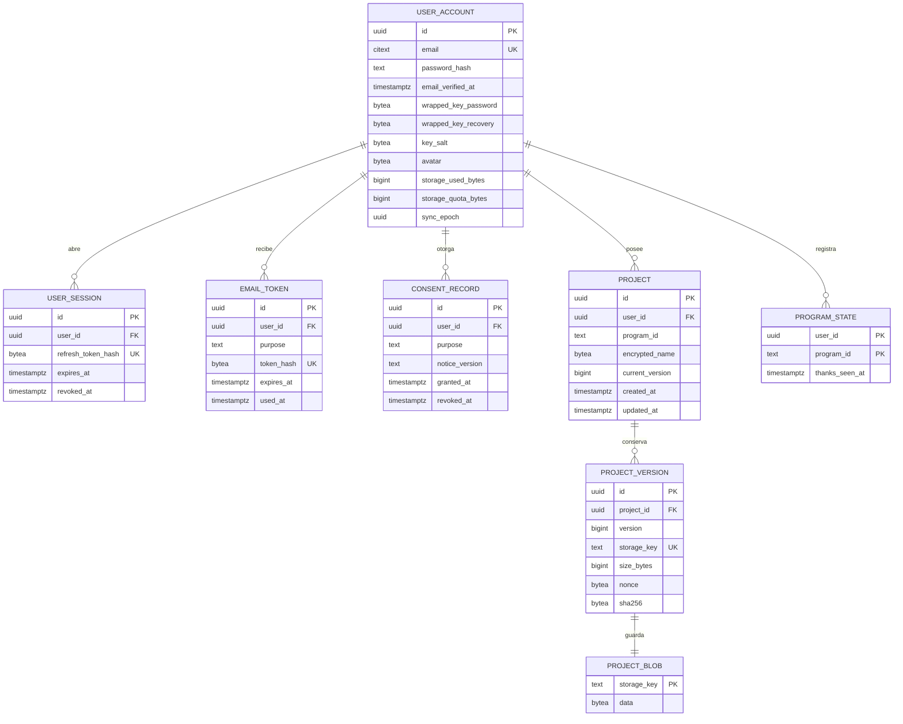

# Modelo de datos

El servidor guarda lo mínimo. El contenido de los proyectos llega cifrado y **los nombres de proyecto también**: así el servidor no conoce ni el título del trabajo. Esto va un paso más allá del documento original, que dejaba el nombre visible.

Migraciones: `V1__init.sql` (cuentas y proyectos) y `V2__project_sync.sql` (fase 6: bytes cifrados, época de sincronización y restricciones), en `backend/src/main/resources/db/migration/`.

## Reglas y su origen

| Regla | Campo o restricción | Origen |
|---|---|---|
| Solo correo y contraseña; sin teléfono, cédula ni nacimiento | `user_account` sin esos campos | Pedido + LOPDP art. 10 (minimización) |
| Foto opcional, máximo 256 KB | `CHECK` sobre `avatar` | Pedido; límite propuesto |
| Contraseña con Argon2id | `password_hash` | OWASP; documento ESTRELLA |
| Tokens guardados solo como hash | `token_hash`, `refresh_token_hash` | Buena práctica OWASP |
| Consentimiento por finalidad, versionado y revocable | `consent_record` | LOPDP art. 8 |
| Borrado real en cascada | `ON DELETE CASCADE` más borrado del almacén | LOPDP art. 15; T-10 |
| Versiones para no pisar trabajo entre dispositivos | `current_version`, `UNIQUE(project_id, version)` | Pedido: "nunca se pierda nada" |
| Agradecimiento una vez por programa | `PROGRAM_STATE` | Pedido |
| Cuota por usuario | `storage_quota_bytes` (25 MiB por defecto) y `storage_used_bytes <= storage_quota_bytes` | Límites de plan gratuito (Neon: 0,5 GB) |
| Solo texto cifrado en el servidor | `encrypted_name` (29 a 2048 bytes) y `project_blob.data`: nonce de 12 bytes, cifrado AES-GCM y etiqueta | T-09; el contenido se cifra en el equipo |
| No pisar trabajo entre equipos | `If-Match` con la versión de partida; si no coincide, 412 y el equipo guarda una copia | RFC 9110; T-08 |
| Últimas 5 versiones por proyecto | Las anteriores se borran al subir una nueva, o antes si falta espacio | Cuota |
| Los bytes se borran con su versión | `project_blob.storage_key` → `project_version.storage_key` con `ON DELETE CASCADE` | LOPDP art. 15; T-10 |
| Retirar la nube borra la copia del servidor | Al revocar `PROJECT_SYNC` se borran los proyectos y cambia `sync_epoch` | LOPDP art. 15.6 |
| Época de sincronización | `sync_epoch` cambia cuando el servidor vacía la nube; los equipos vuelven a subir en vez de borrar | Evita perder trabajo local |
| Contenido atado a su dueño, proyecto y versión | Datos asociados de AES-GCM: `estrella:v1:content:<usuario>:<proyecto>:<versión>` | El servidor no puede intercambiar ni retroceder versiones |

## Sin base de datos

- **Catálogo de programas:** archivo de datos versionado, con su fuente; `program_id` referencia su identificador.
- **Equivalencias:** datos versionados.
- **Llave de IA:** solo en el navegador del estudiante; nunca en el servidor.
- **Autoguardado local:** IndexedDB/OPFS del dispositivo.
- **Límite de intentos de login:** en memoria o caché; caduca solo.

## Claves

Se genera una clave maestra aleatoria en el dispositivo. Se guarda en el servidor envuelta dos veces: con una clave derivada de la contraseña y con el código de recuperación. El servidor nunca ve la clave sin envolver. La contraseña usada para iniciar sesión no debe coincidir con la derivación usada para cifrar; se separan con derivaciones distintas.
